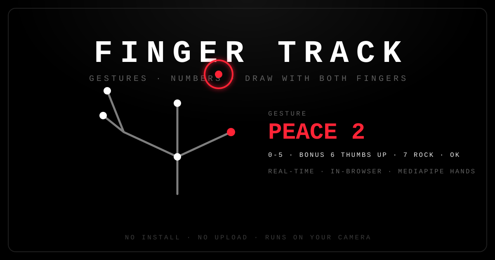

# FINGER TRACK

**Real-time hand tracking in the browser.** Detect hand gestures, read numbers `0–7`, and draw in the air with both index fingers — no install, no upload, no server round-trip. Everything runs locally on your camera using [MediaPipe Hands](https://developers.google.com/mediapipe).



[](LICENSE)


[](#contributing)

---

## Features

- ✋ **Dual-hand tracking** — follows up to two hands with a 21-point landmark overlay.
- 🔢 **Gesture → number** — maps poses to `0–7`, including bonus `6` (thumbs up), `7` (rock), and the `OK` sign.
- 🖌️ **Air drawing** — toggle **Draw** and trace shapes with either index finger.
- 🎨 **Two brushes** — independent colors for hand 1 and hand 2, with preset swatches and a custom color picker.
- 🪞 **Mirror toggle** — flip the camera feed for a natural "selfie" view.
- 📊 **Live HUD** — FPS, per-hand confidence, index position, speed, and a finger state indicator (`T I M R P`).
- 📴 **Fully offline** — MediaPipe runtime and models are vendored in `vendor/mediapipe/`, so no CDN or internet is required at runtime.

## Gesture reference

| Gesture | Number | Notes |
| --- | :---: | --- |
| Fist | `0` | Also used as the fallback pose |
| Point | `1` | Index finger extended |
| Peace / V | `2` | Index + middle |
| Three | `3` | Index + middle + ring |
| Four | `4` | All four fingers, thumb folded |
| Open palm | `5` | All five extended |
| Thumbs up | `6` | Bonus |
| Rock / Rock on | `7` | Bonus |
| OK sign | `0` | Thumb–index pinch with open fingers |

## Quick start

The demo is a single static page, but it **must be served over a local web server** — browsers block the MediaPipe WebAssembly/model files when the page is opened directly as `file://`.

Pick whichever you have handy:

```bash
# Python 3
python -m http.server 8000

# Node
npx serve .

# PHP
php -S localhost:8000
```

Then open <http://localhost:8000> and click **\[ Start Camera ]**.

> **Camera permission:** allow camera access when prompted. The feed never leaves your device.

## Project structure

```
finger-track/
├── index.html              # The entire app (UI, styling, and logic)
├── assets/
│   ├── favicon.svg         # Site icon
│   └── preview.svg         # Social / README preview banner
├── vendor/
│   └── mediapipe/          # Vendored MediaPipe Hands runtime + models
│       ├── hands.js
│       ├── hands.binarypb
│       ├── hand_landmark_full.tflite
│       ├── hand_landmark_lite.tflite
│       └── ...wasm / .data files
├── LICENSE
├── README.md
└── .gitignore
```

## How it works

1. `getUserMedia` opens the front camera and mirrors it into a `<video>` element.
2. Each animation frame is handed to `MediaPipe Hands`, which returns 21 landmarks per hand.
3. Custom logic (`fingerStates` / `gestureOf`) classifies each pose into a named gesture and number.
4. The canvas draws the video frame, the landmark skeleton, an on-screen gesture banner, and any in-air strokes.
5. When **Draw** is on, the index-finger tip is smoothed and appended to a stroke that is rendered with a glow.

## Deployment (GitHub Pages)

This repo is static, so it deploys as-is:

1. Push to GitHub.
2. **Settings → Pages → Source → Deploy from a branch**, choose `main` / `root`.
3. Open `https://<your-username>.github.io/<repo-name>/` and grant camera access.

HTTPS (which Pages provides) satisfies the browser's secure-context requirement for camera access.

## Browser support

Any modern Chromium-based browser, Firefox, or Safari with WebAssembly and `getUserMedia` support. A secure context (HTTPS or `localhost`) is required for the camera.

## Contributing

Issues and pull requests are welcome. Please keep changes consistent with the existing single-file, zero-build approach.

## License

Released under the [MIT License](LICENSE).

**MediaPipe** (vendored in `vendor/mediapipe/`) is © Google LLC and licensed under the [Apache License 2.0](https://www.apache.org/licenses/LICENSE-2.0). See [`vendor/mediapipe/VENDOR.md`](vendor/mediapipe/VENDOR.md) for provenance.
